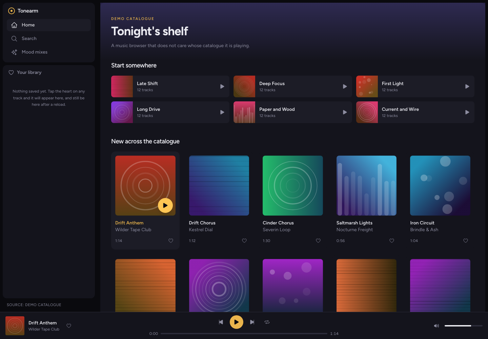
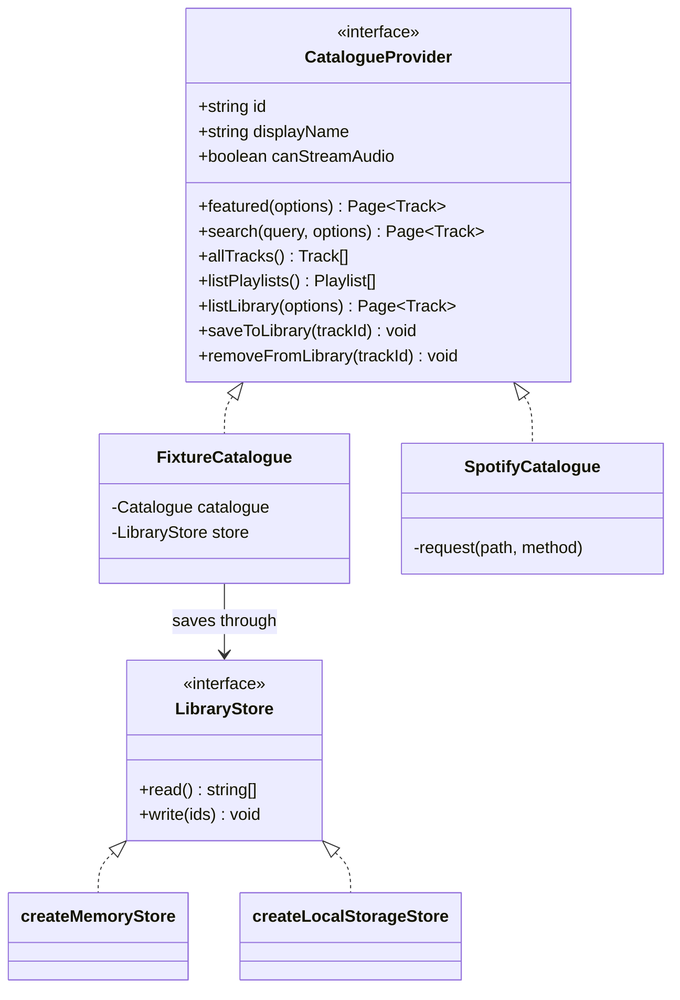
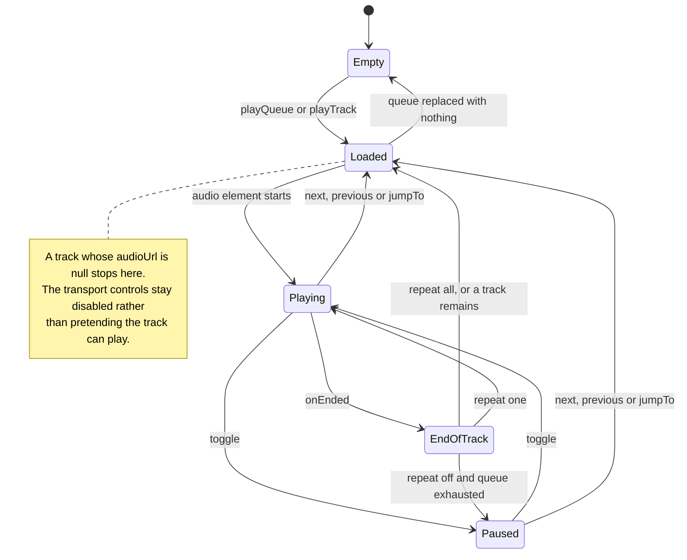
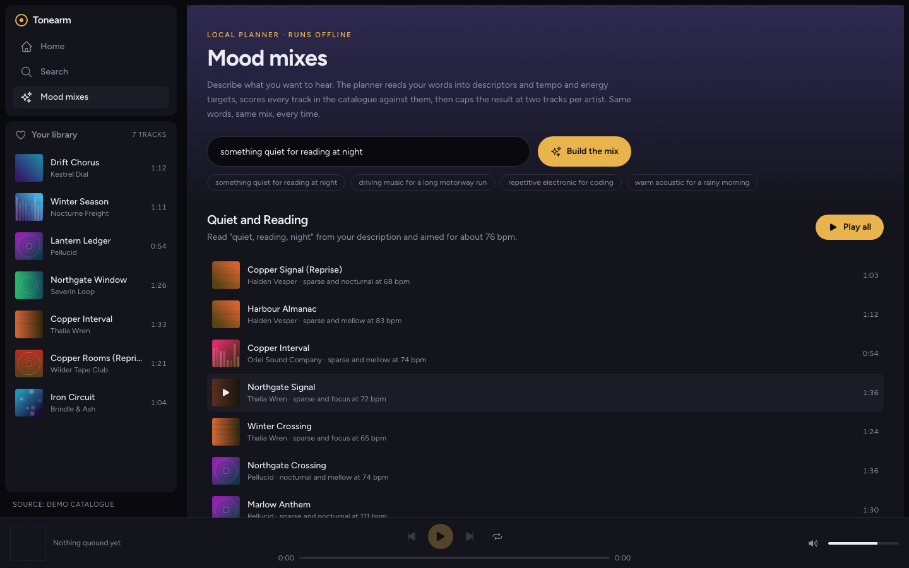
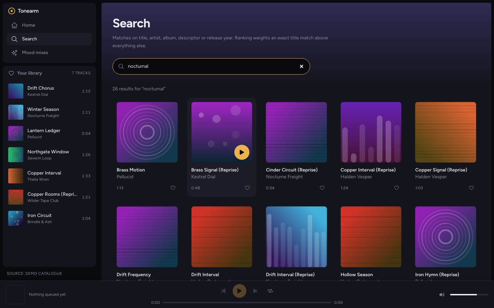

# Tonearm

A music browser and player built against a catalogue _interface_ rather than a
catalogue. The default implementation is a demo catalogue generated on the
machine you run it on — 12 artists, 15 albums, 84 tracks, 6 playlists — with
synthesised audio and generated cover art, so a fresh clone is populated and
playable with no account, no API key and no network.



```bash
npm install
npm run dev     # http://localhost:3000
```

That is the whole setup. There is no `.env` step before the app does something.

## Where the music comes from

Everything the UI renders goes through one interface, `CatalogueProvider`
(`lib/catalogue/provider.ts`). No component imports a data source directly; they
call `getCatalogue()` and get whatever the configuration selected.



| Provider            | `canStreamAudio` | Needs credentials | What it is                                                                                             |
| ------------------- | ---------------- | ----------------- | ------------------------------------------------------------------------------------------------------ |
| `fixture` (default) | yes              | no                | A catalogue generated from `lib/catalogue/fixture/seed.ts`, with audio and artwork rendered on request |
| `spotify`           | no               | yes               | A Spotify Web API adapter, PKCE only                                                                   |

The Spotify adapter reports `canStreamAudio: false` and maps every track to
`audioUrl: null`, because the Web API returns metadata and never audio. The
player respects that and leaves its transport controls disabled rather than
showing a play button that does nothing. Selecting `spotify` without a client id
falls back to the demo catalogue instead of throwing — that rule is one function,
`selectProvider`, and it has its own test.

## What the player is actually doing

One `<audio>` element lives at the root of the app, owned by `PlayerProvider`,
so the queue survives navigating between pages. Every queue transition is a pure
function in `lib/player/queue.ts` — the React layer only moves the media element
to match.



Two behaviours worth naming, because both are in the tests:

- **Previous** restarts the current track if more than three seconds have
  elapsed, and only steps back otherwise.
- **Repeat off** at the end of the queue holds position on the last track and
  stops; it does not wrap silently.

## Generated media

The demo catalogue is invented, so its media has to be too. Nothing is
downloaded, hotlinked or committed as a binary.

**Cover art** — `GET /api/art/[seed]` returns an SVG built from a deterministic
PRNG seeded on the album id: a two-stop gradient plus one of four motifs (arcs,
bars, grooves, orbit). The same id gives byte-identical output forever, so the
response is served `immutable`.

**Audio** — `GET /api/audio/[trackId]` synthesises a minor-pentatonic arpeggio
over a drone and encodes it as 16-bit mono PCM at 22.05 kHz. Clips run 48 to 96
seconds, and a track's advertised duration _is_ its clip length, so the seek bar
is measuring real audio rather than a number from a fixture table. At that rate a
full-length clip is a little over 4 MB, generated per request and never stored.

## Mood mixes, without a model



Describe what you want to hear and `MoodPlanner` returns a twelve-track mix. The
one registered implementation, `LocalMoodPlanner`, runs entirely offline:

1. **Read** the prompt into tag weights and tempo/energy targets, using the
   lexicon in `lib/mood/lexicon.ts` — `quiet` raises `sparse` and pulls the
   tempo target to 70 bpm, `workout` raises `driving` and pushes it to 140.
2. **Score** every track. Descriptor match decides which tracks are candidates;
   tempo closeness is a _multiplier_ on that score, not another addend. Added, it
   was worth a handful of points against a descriptor score of a hundred, and the
   planner happily put a 139 bpm track in a list for reading at night.
3. **Select** the best, capped at two tracks per artist so a twelve-track mix is
   not one album.

It is deterministic — the same sentence gives the same mix — which is what makes
it testable and what makes it a usable fallback rather than a placeholder. A
hosted model would be a second class implementing the same interface and one
entry in `lib/mood/registry.ts`; nothing under `app/` or `components/` would
change. None is wired today, and the page says so on its own header.

## Search



Search matches title, artist, album, descriptor tag and release year, weighted so
an exact title match outranks a substring, which outranks an artist match. Input
is debounced, and `useAsync` carries a sequence counter so a slow response for
`a` cannot overwrite the results for `ambient` typed after it. Results are paged;
the provider caps any page at 100 items however large a limit a caller asks for.

## Environment

Copy `.env.example` to `.env.local` if you want to change anything. Nothing in it
is required for the default configuration.

| Variable                         | Default                        | Notes                                               |
| -------------------------------- | ------------------------------ | --------------------------------------------------- |
| `NEXT_PUBLIC_CATALOGUE_PROVIDER` | `fixture`                      | `fixture` or `spotify`                              |
| `NEXT_PUBLIC_SPOTIFY_CLIENT_ID`  | empty                          | Only for `spotify`                                  |
| `NEXT_PUBLIC_SPOTIFY_AUTH_URL`   | `https://accounts.spotify.com` |                                                     |
| `NEXT_PUBLIC_SPOTIFY_API_URL`    | `https://api.spotify.com`      |                                                     |
| `NEXT_PUBLIC_APP_URL`            | `http://localhost:3000`        | The OAuth redirect is derived as `${this}/callback` |
| `MOOD_PLANNER`                   | `local`                        | Only `local` is registered                          |

Every `process.env` read in the app is in `lib/config.ts`. Nothing else touches
the environment.

**There is no client secret, and there must never be one.** The Spotify adapter
uses authorisation-code-with-PKCE precisely so a browser client does not need
one, and every `NEXT_PUBLIC_*` value is compiled into the JavaScript bundle and
served to anyone who opens the page. The redirect URI is derived from
`NEXT_PUBLIC_APP_URL` rather than hardcoded, so it follows the port you actually
run on.

`GET /api/health` reports the selected provider, whether Spotify is configured,
and the size of the catalogue currently being served.

## Tests

```bash
npm test        # vitest
npm run lint    # eslint, flat config
npm run typecheck
```

88 tests across 8 files: queue transitions, pagination limits, search ranking,
the fixture provider's library semantics, WAV header bytes and clip determinism,
artwork determinism, the Spotify DTO mapper against payloads with missing album
art, the mood planner's interpretation and tempo weighting, and a jsdom pass over
`TrackCard` and `PlayerBar` covering play, save/unsave, repeat cycling and mute.

## Container

```bash
docker compose up --build   # http://localhost:3000
```

Multi-stage build on `node:22-alpine`, running Next's `standalone` output as a
non-root user, with a healthcheck against `/api/health`. `docker compose config`
parses. The image has **not** been built or booted — Docker was unavailable on
the machine this was last worked on, so treat the build as unverified.

## Layout

```
app/              routes: /, /search, /moods, /callback, plus api/{health,art,audio}
components/       ui primitives, layout, track, player
contexts/         PlayerProvider (one <audio> element), LibraryProvider
hooks/            useAsync, useDebouncedValue, useSpotifySession
lib/
  catalogue/      the provider interface, registry, fixture and spotify adapters
  media/          seeded PRNG, SVG artwork, WAV synthesis
  mood/           planner interface, lexicon, local planner
  player/         pure queue transitions
  config.ts       every environment read
tests/            vitest suite
```

## What this is not

- Not a Spotify client. The name, look and catalogue are its own. The Spotify
  adapter exists to prove the interface has more than one implementation, and it
  cannot be exercised here — that would need a registered application and a
  callback URL.
- Not a streaming service. The demo audio is synthesised tones, deliberately: a
  player with nothing to play is a screenshot, not a feature.
- Not multi-user. The demo library is a `localStorage` key on your own browser.

## Playback check

A native production run was opened in Chromium. The demo track advanced through
the HTML audio element and paused when requested. This verifies the synthesised
fixture audio; it does not verify Spotify streaming.
[Recorded checks](docs/native-verification.json). Use Node.js 22.12 or newer.
